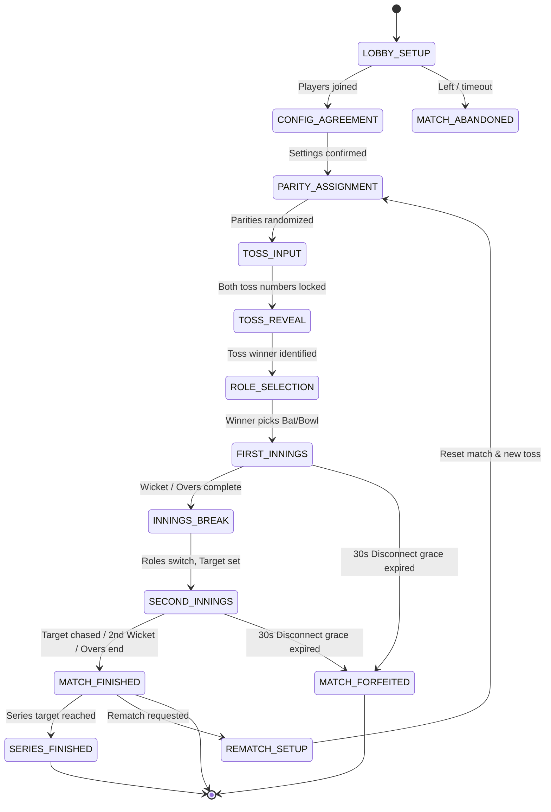

# Odd or Even - Game State Machine

## 1. State Diagram

## 2. State Definitions & Transitions

| Phase | Description | Allowed Client Actions | Transitions To |
|---|---|---|---|
| `lobbySetup` | Room creation / waiting for Player 2 | Leave room, update proposed config | `configAgreement` |
| `configAgreement` | Both players reviewing proposed match rules | Propose change, Confirm settings | `parityAssignment` (when both confirmed) |
| `parityAssignment` | Parities (ODD/EVEN) generated randomly | Visual animation only | `tossInput` |
| `tossInput` | Both players select 1..10 for toss | Submit secret toss number (1..10) | `tossReveal` (when both submitted) |
| `tossReveal` | Sum evaluated; winner announced | Acknowledge / auto-advance (2s) | `roleSelection` |
| `roleSelection` | Toss winner chooses Bat or Bowl | Toss winner selects 'bat' or 'bowl' | `firstInnings` |
| `firstInnings` | Batter & Bowler submit numbers each ball | Submit secret number (1..10) | `inningsBreak` (on wicket or balls cap) |
| `inningsBreak` | Target announced (`firstScore + 1`); roles swap | Acknowledge / auto-advance (3s) | `secondInnings` |
| `secondInnings` | Chasing team bats; defending bowls | Submit secret number (1..10) | `matchFinished` (target hit / out / balls end) |
| `matchFinished` | Individual match outcome displayed | Request rematch, return home | `rematchSetup` or `seriesFinished` |
| `seriesFinished` | Series target achieved; overall winner crowned | Return to menu, new series | `[*]` |
| `matchForfeited` | Opponent abandoned or disconnect grace ran out | Return to menu | `[*]` |

## 3. Disconnection & Reconnection Flags
Connection state is maintained independently of game phase. A player may have `connection_status: 'disconnected'` while the match phase remains in `firstInnings`.
- When a player disconnects, `grace_deadline_at` is set to `now() + 30s`.
- The active decision timer is paused.
- If the player reconnects before `grace_deadline_at`, timer resumes.
- If `now() > grace_deadline_at`, server executes `forfeit_match(match_id, disconnected_user_id)`.
