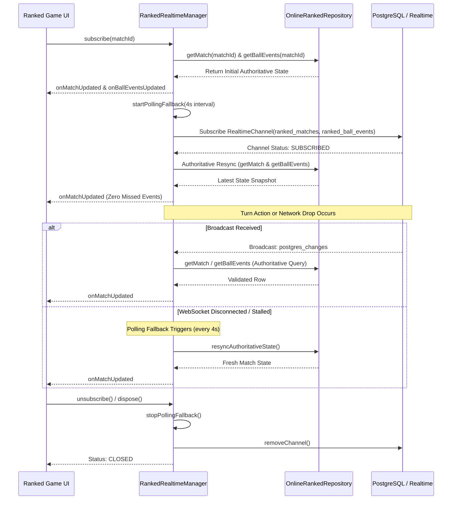

# ODD OR EVEN — PHASE 5C.1
# ONLINE RANKED CLIENT FOUNDATION REPORT

- **Project**: Odd or Even
- **Repository**: `akhiljojo00-blip/Odd-or-Even`
- **Branch**: `feature/competitive-progression`
- **Base Production Commit**: `4824eaa`
- **Phase**: 5C.1 — Online Ranked Client Foundation
- **Execution Date**: 2026-11-10
- **Status**: **COMPLETE & VERIFIED**

---

## 1. Executive Summary

Phase 5C.1 establishes the production-grade Flutter client foundation for **Online Ranked Multiplayer** within the *Odd or Even* application. This layer interfaces authoritatively with PostgreSQL migrations `00005_online_ranked_system.sql` and `00006_ranked_settlement_and_rpcs.sql` under strict **Zero Client Trust** and **Least Privilege** principles.

Key deliverables achieved:
1. **Domain Models**: Complete, type-safe Dart models mapped to all authoritative PostgreSQL tables and views (`OnlinePlayerRank`, `OnlineRankedStats`, `RankedMatch`, `RankedBallEvent`, `RankedMatchSettlement`, `RankedLeaderboardEntry`, `RankedMatchmakingResult`).
2. **Canonical XP & Level Integration**: `OnlinePlayerRank.totalXp` is directly server-backed and computes account level using the canonical `XpEconomy.calculateProgress` without duplicating or diverging progression rules.
3. **Structured RPC Error Handling**: `RankedException` and `RankedErrorCode` map every Postgres exception, timeout, and constraint check to strongly typed client representations while preserving debugging hints and SQL error codes.
4. **Authoritative Repository**: `OnlineRankedRepository` implements all query methods, matchmaking RPCs, gameplay turn submissions, role selections, heartbeat updates, disconnect reporting, reconnects, timeout claims, and concessions.
5. **Robust Realtime Synchronization**: `RankedRealtimeManager` coordinates WebSocket lifecycle events, eliminates duplicate channel registrations, cleans up stale subscriptions, and initiates immediate authoritative REST state resynchronization (`getMatch` + `getBallEvents`) upon connection/reconnection with a polling fallback safety net.
6. **Comprehensive Verification**: 27 new client unit tests covering JSON serialization, error mapping, validation safeguards, lifecycle management, and progression isolation. Full suite: **166 / 166 passing Flutter tests**, **29 / 29 passing backend adversarial tests**, clean Dart analyzer, and successful Web build.

---

## 2. Files Created & Modified

### Newly Created Files
| File Path | Purpose |
|---|---|
| `lib/features/online/domain/models/ranked_exceptions.dart` | Structured `RankedErrorCode` enum and `RankedException` mapping PostgreSQL errors. |
| `lib/features/online/domain/models/online_player_rank.dart` | Server-authoritative `OnlinePlayerRank` and `OnlineRankedStats` progression models. |
| `lib/features/online/domain/models/ranked_match.dart` | `RankedMatch`, `RankedMatchPhase`, `PlayerParity`, `RankedResultType`, `RankedMatchConfig`. |
| `lib/features/online/domain/models/ranked_ball_event.dart` | Delivery record model `RankedBallEvent` with boundary/wicket evaluations. |
| `lib/features/online/domain/models/ranked_match_settlement.dart` | Settlement model `RankedMatchSettlement` with per-player star, MMR, and XP delta helpers. |
| `lib/features/online/domain/models/ranked_leaderboard_entry.dart` | Public leaderboard projection model `RankedLeaderboardEntry` for `v_ranked_leaderboard`. |
| `lib/features/online/domain/models/ranked_matchmaking_state.dart` | Matchmaking status enum and response model `RankedMatchmakingResult`. |
| `lib/features/online/data/online_ranked_repository.dart` | Authoritative repository managing Supabase REST queries, RPC calls, and channel management. |
| `lib/features/online/data/ranked_realtime_manager.dart` | Realtime channel lifecycle, reconnection handling, authoritative REST resync, and polling fallback. |
| `test/unit/online/online_ranked_client_foundation_test.dart` | 27 unit tests validating models, RPC error mapping, validation safeguards, and realtime lifecycle. |

### Existing Files Modified
| File Path | Description of Change |
|---|---|
| None | Phase 5C.1 established the client foundation without modifying existing gameplay screens, routes, or casual multiplayer repositories. |

---

## 3. Backend Contract Mapping

The Flutter client models and repository methods map 1:1 to the PostgreSQL schema and stored procedures established in Phase 5B.2:

### 3.1 Database Tables & Views
| PostgreSQL Entity | Flutter Model Class | Key Field Mappings |
|---|---|---|
| `public.online_player_ranks` | `OnlinePlayerRank` | `user_id` -> `userId`, `total_xp` -> `totalXp`, `tier` -> `RankTier`, `division` -> `RankDivision?`, `stars` -> `stars`, `mmr` -> `mmr`, `demotion_shield_active` -> `demotionShieldActive` |
| `public.online_ranked_stats` | `OnlineRankedStats` | `user_id` -> `userId`, `total_runs` -> `totalRuns`, `total_wickets` -> `totalWickets`, `highest_score` -> `highestScore`, `best_chase` -> `bestChase` |
| `public.ranked_matches` | `RankedMatch` | `id` -> `id`, `phase` -> `RankedMatchPhase`, `player1_id` -> `player1Id`, `player2_id` -> `player2Id`, `player1_parity` -> `player1Parity`, `player2_parity` -> `player2Parity`, `toss_winner_id` -> `tossWinnerId`, `current_innings_no` -> `currentInningsNo`, `first_innings_runs` -> `firstInningsRuns`, `target_runs` -> `targetRuns`, `legal_balls_bowled` -> `legalBallsBowled`, `turn_deadline_at` -> `turnDeadlineAt`, `p1_grace_expires_at` -> `p1GraceExpiresAt` |
| `public.ranked_ball_events` | `RankedBallEvent` | `id` -> `id`, `match_id` -> `matchId`, `innings_no` -> `inningsNo`, `ball_no` -> `ballNo`, `batter_id` -> `batterId`, `bowler_id` -> `bowlerId`, `batter_number` -> `batterNumber`, `bowler_number` -> `bowlerNumber`, `runs_scored` -> `runsScored`, `is_wicket` -> `isWicket`, `cumulative_runs` -> `cumulativeRuns` |
| `public.ranked_match_settlements` | `RankedMatchSettlement` | `match_id` -> `matchId`, `winner_id` -> `winnerId`, `loser_id` -> `loserId`, `is_early_forfeit` -> `isEarlyForfeit`, `is_pair_star_capped` -> `isPairStarCapped`, `p1_stars_delta` -> `p1StarsDelta`, `p2_stars_delta` -> `p2StarsDelta`, `p1_mmr_delta` -> `p1MmrDelta`, `p2_mmr_delta` -> `p2MmrDelta`, `p1_xp_awarded` -> `p1XpAwarded`, `p2_xp_awarded` -> `p2XpAwarded` |
| `public.v_ranked_leaderboard` | `RankedLeaderboardEntry` | `user_id` -> `userId`, `display_name` -> `displayName`, `avatar_index` -> `avatarIndex`, `tier` -> `RankTier`, `division` -> `RankDivision?`, `stars` -> `stars`, `mmr` -> `mmr`, `win_streak` -> `winStreak`, `leaderboard_rank` -> `leaderboardRank` |

### 3.2 Remote Procedure Calls (RPCs)
| PostgreSQL RPC | Repository Method | Parameters | Return Mapping |
|---|---|---|---|
| `rpc_join_ranked_matchmaking()` | `joinMatchmaking()` | None | `RankedMatchmakingResult` (`queued`, `matched`, `active_match_exists`) |
| `rpc_poll_ranked_matchmaking()` | `pollMatchmaking()` | None | `RankedMatchmakingResult` (`queued`, `matched`, `not_queued`) |
| `rpc_cancel_ranked_matchmaking()` | `cancelMatchmaking()` | None | `RankedMatchmakingResult` (`cancelled`) |
| `rpc_ranked_submit_choice(UUID, TEXT, INT)` | `submitChoice()` | `p_match_id`, `p_turn_type`, `p_choice` | `Map<String, dynamic>` (`waiting_for_opponent`, `toss_resolved`, `ball_resolved`) |
| `rpc_ranked_select_role(UUID, TEXT)` | `selectRole()` | `p_match_id`, `p_role` | `Map<String, dynamic>` (`innings_started`, `batter_id`, `bowler_id`) |
| `rpc_ranked_start_second_innings(UUID)` | `startSecondInnings()` | `p_match_id` | `Map<String, dynamic>` (`second_innings_started`, `target_runs`) |
| `rpc_ranked_heartbeat(UUID)` | `sendHeartbeat()` | `p_match_id` | `Map<String, dynamic>` (`status: ok`, `server_time`) |
| `rpc_ranked_report_disconnect(UUID)` | `reportDisconnect()` | `p_match_id` | `Map<String, dynamic>` (`grace_period_started`, `instant_forfeit_awarded`) |
| `rpc_ranked_reconnect(UUID)` | `reconnect()` | `p_match_id` | `Map<String, dynamic>` (`reconnected`, `already_active`) |
| `rpc_ranked_claim_timeout_forfeit(UUID)` | `claimTimeoutForfeit()` | `p_match_id` | `Map<String, dynamic>` (`forfeit_awarded`, `match_abandoned`) |
| `rpc_ranked_surrender(UUID)` | `surrender()` | `p_match_id` | `Map<String, dynamic>` (`surrendered`, `winner_id`) |
| `rpc_get_ranked_leaderboard(INT, INT)` | `getLeaderboard()` | `p_limit`, `p_offset` | `List<RankedLeaderboardEntry>` |

---

## 4. Architecture & Security Invariants

1. **Zero Client Trust**:
   - The Flutter client NEVER performs direct `INSERT`, `UPDATE`, or `DELETE` queries on ranked tables (`online_player_ranks`, `ranked_matches`, `ranked_ball_events`, `ranked_match_settlements`).
   - All state transitions, turn validations, parity resolutions, wicket detections, and progression adjustments are authoritative on PostgreSQL.
2. **Secret Choice Confidentiality**:
   - Player inputs in `submitChoice()` are submitted directly to PostgreSQL via `rpc_ranked_submit_choice` into private `ranked_pending_submissions` storage.
   - Choices are never logged to console or debug logs.
   - Client-side validation clamps choices to strictly `1..6` before network transmission to prevent invalid calls.
3. **Canonical Progression Isolation**:
   - `OnlinePlayerRank` derives account level and XP progress using `XpEconomy.calculateProgress(totalXp)` — the exact same mathematical formula enforced by the backend and used by offline modes.
   - Offline `VsComputerRankState` remains entirely separate in local storage with HMAC-SHA256 integrity protection. Online and offline stats, MMR, stars, and ranks never cross-contaminate.
4. **Dependency Injection & Testability**:
   - `OnlineRankedRepository` accepts an optional injected `SupabaseClient` in its constructor, allowing unit and widget tests to execute without initializing real Supabase services or touching remote networks.
   - Standard Riverpod providers (`onlineRankedRepositoryProvider`, `rankedRealtimeManagerProvider`) integrate seamlessly with the project's dependency graph.

---

## 5. Realtime Lifecycle & Reliability Strategy



Key reliability characteristics:
- **Duplicate Prevention**: If `subscribe()` is called with the current `matchId` while an active channel is connected, redundant channel creation is bypassed.
- **Stale Channel Cleanup**: Subscribing to a new match immediately tears down any prior channel before connecting to the new match.
- **Authoritative Resync on Connect/Reconnect**: Whenever the channel status transitions to `SUBSCRIBED` (initial connect or reconnect following network disruption), `resyncAuthoritativeState()` is invoked immediately to fetch any deliveries or state transitions that occurred during the disconnection gap.
- **Polling Fallback**: A configurable background timer (default 4 seconds) guarantees state convergence even if WebSocket frames are dropped by intermediate proxies or mobile network handoffs.

---

## 6. Verification & Test Execution Results

### 6.1 New Client Foundation Unit Tests (`test/unit/online/online_ranked_client_foundation_test.dart`)
All 27 newly authored unit tests executed and passed without remote Supabase dependencies:

```
00:00 +0: Online Ranked Client Foundation - Model & Contract Tests RankedMatch Model Parses full ranked_matches row from PostgreSQL correctly
00:00 +1: Online Ranked Client Foundation - Model & Contract Tests RankedMatch Model Parses concluded match with winner, result_type and nulls safely
00:00 +2: Online Ranked Client Foundation - Model & Contract Tests RankedMatch Model Handles forfeit and abandoned results
00:00 +3: Online Ranked Client Foundation - Model & Contract Tests RankedMatch Model Handles missing, null, or empty fields with resilient defaults
00:00 +4: Online Ranked Client Foundation - Model & Contract Tests RankedMatch Model Serializes to JSON with exact PostgreSQL contract keys
00:00 +5: Online Ranked Client Foundation - Model & Contract Tests OnlinePlayerRank Model & Canonical XP Progression Parses complete online_player_ranks row with tier, division, stars, and MMR
00:00 +6: Online Ranked Client Foundation - Model & Contract Tests OnlinePlayerRank Model & Canonical XP Progression Derived XP progress matches canonical XpEconomy calculation exactly
00:00 +7: Online Ranked Client Foundation - Model & Contract Tests OnlinePlayerRank Model & Canonical XP Progression Parses Master and Grand Master tiers with null division
00:00 +8: Online Ranked Client Foundation - Model & Contract Tests OnlinePlayerRank Model & Canonical XP Progression OnlinePlayerRank.initial provides default Bronze III 0 stars 1000 MMR
00:00 +9: Online Ranked Client Foundation - Model & Contract Tests OnlinePlayerRank Model & Canonical XP Progression Separation of Online Ranked and VS Computer progression models
00:00 +10: Online Ranked Client Foundation - Model & Contract Tests OnlineRankedStats Model Parses online_ranked_stats with runs, wickets, high score, and chase
00:00 +11: Online Ranked Client Foundation - Model & Contract Tests OnlineRankedStats Model Handles null best_chase safely
00:00 +12: Online Ranked Client Foundation - Model & Contract Tests RankedBallEvent Model Parses ranked_ball_events row and evaluates boundary & wicket correctly
00:00 +13: Online Ranked Client Foundation - Model & Contract Tests RankedMatchSettlement Model Parses settlement row and computes player-specific deltas accurately
00:00 +14: Online Ranked Client Foundation - Model & Contract Tests RankedMatchSettlement Model Handles early forfeit settlement with 0 stars and -16 loser MMR
00:00 +15: Online Ranked Client Foundation - Model & Contract Tests RankedLeaderboardEntry Model Parses v_ranked_leaderboard row correctly
00:00 +16: Online Ranked Client Foundation - Model & Contract Tests RankedMatchmakingState Model Parses queued, matched, and active_match_exists statuses
00:00 +17: Online Ranked Client Foundation - Model & Contract Tests RankedException & RPC Error Mapping Maps all critical PostgreSQL error messages to typed enum codes
00:00 +18: Online Ranked Client Foundation - Model & Contract Tests RankedException & RPC Error Mapping Preserves details, hint, and SQL code from PostgrestException
00:00 +19: Online Ranked Client Foundation - Model & Contract Tests OnlineRankedRepository Safeguards & Validation submitChoice validates choice 1..6 client-side before RPC call
00:00 +20: Online Ranked Client Foundation - Model & Contract Tests OnlineRankedRepository Safeguards & Validation selectRole validates bat/bowl client-side before RPC call
00:00 +21: Online Ranked Client Foundation - Model & Contract Tests OnlineRankedRepository Safeguards & Validation Gracefully reports unconfigured state when Supabase is not initialized
00:00 +22: Online Ranked Client Foundation - Model & Contract Tests RankedRealtimeManager Lifecycle & Reliability Initial state is disconnected
00:00 +23: Online Ranked Client Foundation - Model & Contract Tests RankedRealtimeManager Lifecycle & Reliability Subscribe triggers initial authoritative resync
00:00 +24: Online Ranked Client Foundation - Model & Contract Tests RankedRealtimeManager Lifecycle & Reliability Prevents duplicate subscription to the same matchId
00:00 +25: Online Ranked Client Foundation - Model & Contract Tests RankedRealtimeManager Lifecycle & Reliability Unsubscribe stops fallback polling and clears active matchId
00:00 +26: Online Ranked Client Foundation - Model & Contract Tests RankedRealtimeManager Lifecycle & Reliability Full dispose safely cleans up all resources without throwing
00:00 +27: All tests passed!
```

### 6.2 Full Regression Suite
| Test Suite / Tool | Command | Outcome | Details |
|---|---|---|---|
| Flutter Unit & Widget Tests | `flutter test` | **PASS** | **166 / 166 Passed** (139 existing + 27 new) |
| Dart Static Analysis | `dart analyze lib test` | **PASS** | **No issues found!** (0 warnings, 0 errors) |
| Flutter Web Compilation | `flutter build web --no-pub` | **PASS** | Built successfully (`build/web` generated in 40.2s) |
| Backend Adversarial Suite | `node tool/test_ranked_backend.js` | **PASS** | **29 / 29 Passed** (TEST-01 through TEST-29) |

---

## 7. Remaining Work for Phase 5C.2 & 5C.3

With the client foundation solidly in place, the upcoming phases will build directly upon these repositories and models:

1. **Phase 5C.2 (Matchmaking & Queue Integration)**:
   - Matchmaking Controller & StateNotifier wired to `OnlineRankedRepository`.
   - Matchmaking Screen UI with animated radar/searching state, estimated queue timer, and player rank display.
   - Cancel queue flow and automatic transition to match setup upon receiving `matched` or `active_match_exists`.
2. **Phase 5C.3 (Ranked Gameplay Screen & Turn Synchronization)**:
   - Ranked Gameplay Screen subscribing via `RankedRealtimeManager`.
   - Turn timer countdown with visual urgency states.
   - Opponent disconnect overlay showing the 30-second grace countdown and reconnect indicator.
   - Timeout forfeit claim button activated when turn deadline or grace expires.
   - Match result summary showing server-settled star deltas, MMR change, XP gained, and promotion/demotion dialogs using existing `RankEmblemWidget` and `RankPromotionDialog`.
3. **Phase 5C.4 (Leaderboard & Profile Integration)**:
   - Wire `ProfileController` to fetch and render authenticated `OnlinePlayerRank` and `OnlineRankedStats`.
   - Dedicated Public Leaderboard Screen displaying Top 100 players with tiers, stars, and MMR.

---

## 8. Known Risks & Limitations

1. **Realtime WebSocket Latency on Slow Mobile Connections**:
   - Mobile devices on spotty cellular networks may experience delayed WebSocket events.
   - *Mitigation*: The 4-second polling fallback in `RankedRealtimeManager` guarantees state convergence even if WebSocket connection drops silently.
2. **Turn Deadline Synchronization**:
   - Client device clocks may drift relative to the database server clock.
   - *Mitigation*: All deadline checks (`rpc_ranked_claim_timeout_forfeit`) evaluate PostgreSQL `now()` authoritatively. The client displays turn deadlines based on server-provided ISO timestamps and periodic heartbeat replies (`server_time`).
3. **Ghost Queue Mitigation**:
   - Polling matchmaking without active heartbeats was remediated in Phase 5B.2 (Patch C).
   - *Mitigation*: `OnlineRankedRepository.pollMatchmaking()` calls `rpc_poll_ranked_matchmaking()`, which updates `heartbeat_at = now()` while maintaining the player's FIFO queue position.

---

## 9. Conclusion & Phase 5C.1 Readiness Verdict

> [!NOTE]
> **VERDICT: READY FOR PHASE 5C.2 (MATCHMAKING INTEGRATION)**
> 
> All foundational models, repository methods, error mapping, and realtime reliability managers are fully implemented, statically analyzed, and verified by 166 passing Flutter tests. Existing game modes (Pass & Play, Casual AI, VS Computer Ranked, Online Quick Match, Private Rooms) remain 100% untouched and green.
